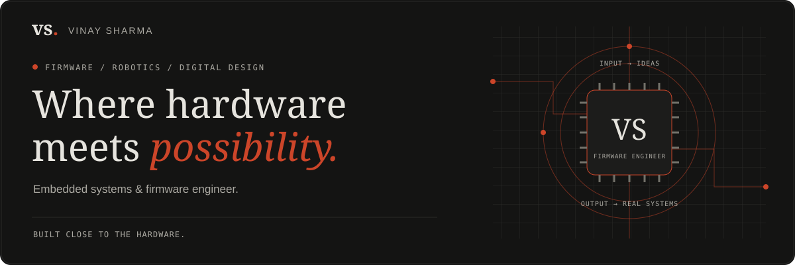

[](https://vinaysh.in)

<p align="center">
  <a href="https://vinaysh.in"><strong>Portfolio ↗</strong></a>
  &nbsp; · &nbsp;
  <a href="https://vinaysh.in/resume.pdf">Resume ↓</a>
  &nbsp; · &nbsp;
  <a href="https://www.linkedin.com/in/vinay-sharma-643422310/">LinkedIn</a>
  &nbsp; · &nbsp;
  <a href="mailto:vinaysharma17005@gmail.com">Email</a>
</p>

I'm **Vinay**, an embedded systems and firmware engineer building the software that brings hardware to life.

Currently a **Graduate Engineer Trainee in R&D at JKW Innovatics**, working on warehouse robotics, real-time control, and sensor integration.

Based in **Greater Noida, India** · **B.Tech ECE, VIT Chennai (2022–2026)**

---

## 01 / Selected work

### [Avionics flight display ↗](https://github.com/Vinay-ix/Real-Time-Avionics-PFD-ESP32)

From sensor readings to flight instrumentation. An educational ESP32-based display prototype combining attitude filtering, barometric altitude, and serial telemetry with a Processing interface.

`ESP32` `C++` `I²C` `UART` `Sensor Fusion` `Processing`

[Source & setup](https://github.com/Vinay-ix/Real-Time-Avionics-PFD-ESP32) · [Demo videos](https://github.com/Vinay-ix/Real-Time-Avionics-PFD-ESP32/tree/main/media/demo)

### [AHB-to-APB bridge ↗](https://github.com/Vinay-ix/AHB-to-APB-Bridge-verification)

Exploring the interface between high-performance and peripheral buses through Verilog bridge modules and read/write simulation examples.

`Verilog` `RTL Design` `AHB / APB` `Simulation`

### [Connected home control ↗](https://github.com/Vinay-ix/home-automation-esp32-blynk)

An ESP32 and Blynk project for smartphone control of a four-channel relay module, bringing a simple hardware interface onto a connected dashboard.

`ESP32` `Arduino` `Blynk IoT` `Wi-Fi`

**Signal processing:** [LMS audio noise reduction in MATLAB](https://github.com/Vinay-ix/Noise-Reduction-in-Signal-Processing-MATLAB)  
[Explore all public repositories ↗](https://github.com/Vinay-ix?tab=repositories)

## 02 / What I bring to the bench

| Area | Focus |
| --- | --- |
| **Firmware & real-time systems** | C/C++, Embedded C, FreeRTOS, microcontroller firmware |
| **Protocols & telemetry** | UART, SPI, I²C, CAN, MQTT |
| **Digital design & RTL** | Verilog, SystemVerilog, FPGA design, ModelSim, Intel Quartus |
| **Hardware integration** | Sensor interfacing, oscilloscope and logic analyzer debugging |
| **Tools & scripting** | Python, MATLAB, Arduino IDE, PlatformIO, Git, Linux |

## 03 / Experience

**JKW Innovatics · Graduate Engineer Trainee, R&D**  
July 2026–present · Greater Noida  
Embedded firmware, real-time control, and sensor integration for autonomous warehouse robotics.

**Mafkin Robotics · Embedded Systems Intern**  
October 2024–January 2025 · Chennai  
Microcontroller firmware, sensor integration, communication interfaces, and hardware debugging for robotics platforms.

## 04 / A little firmware personality

```text
vinay@firmware-shell:~$ whoami

  role       Embedded systems & firmware engineer
  focus      Robotics / real-time control / digital design
  approach   Read the waveform. Trace the signal. Understand the system.
```

---

**Let's build something close to the hardware.**  
[Portfolio](https://vinaysh.in) · [LinkedIn](https://www.linkedin.com/in/vinay-sharma-643422310/) · [LeetCode](https://leetcode.com/u/vinayy_79/) · [Email](mailto:vinaysharma17005@gmail.com)
